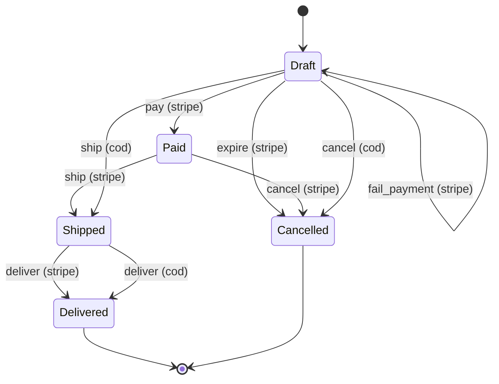

# Order state machine

Every change to an Order's `order_status` and `payment_status` goes through one class, `App\StateMachines\OrderStateMachine`. It owns the table of allowed moves and is the only code that writes those two columns after an Order is created (#82).

This page explains the states, the transition table, how a status change runs, and how to change the rules.

## Why

Before #82, five places changed an Order's status, each with its own rules: the Stripe webhook and success redirect, the Supplier ship/deliver/cancel endpoints, and three Filament screens where an admin could pick any status and type any payment status. That allowed impossible combinations (an Order marked Delivered that was never paid or shipped). It also left Cash-on-Delivery Orders stuck in Draft until an admin marked them Paid by hand, and hid them from their Supplier.

Now the rules live in one table, one method enforces them for every caller, and every screen offers only what the table allows.

## States

An Order has two status columns, which always change together:

| `order_status` (`OrderStatusEnum`) | `payment_status` (`OrderPaymentStatusEnum`) |
|---|---|
| `Draft`: created, not yet paid or shipped | `PENDING`: not paid yet |
| `Paid`: a Stripe payment went through | `PAID`: paid (online, or cash collected on delivery) |
| `Shipped` | `FAILED`: the Stripe payment failed or the session expired |
| `Delivered` (terminal) | |
| `Cancelled` (terminal) | |

Every Order starts as `Draft` / `PENDING`: at checkout (`CreateOrderDTO`) and when an admin creates one in Filament (`CreateOrder`). `Delivered` and `Cancelled` are terminal (`OrderStatusEnum::isTerminal()`): no event is allowed from them.

## Diagram

Generated from the transition table with `OrderStateMachine::toMermaid()`. Each arrow is labelled with its event and payment method.



To regenerate it after changing the table:

```sh
cd backend
php artisan tinker --execute='echo app(App\StateMachines\OrderStateMachine::class)->toMermaid();'
```

## Events and actors

**Events** (`OrderEventEnum`) are the things that can happen to an Order:

| Event | Meaning | Triggered by |
|---|---|---|
| `pay` | The Stripe Checkout Session was paid | Stripe webhook / success redirect |
| `fail_payment` | An async Stripe payment failed | Stripe webhook |
| `expire` | The Checkout Session expired unpaid | Stripe webhook |
| `ship` | The Order was shipped | Supplier or Admin |
| `deliver` | The Order was delivered | Supplier or Admin |
| `cancel` | The Order was cancelled | Supplier or Admin |

**Actors** (`OrderActorEnum`) are who triggers an event. `OrderStateMachine` works out the actor from the user:

| Actor | Who |
|---|---|
| `System` | No logged-in user: the Stripe webhook and success redirect |
| `Admin` | A user with the admin role |
| `Supplier` | A Supplier, **only for an Order whose `supplier_id` is theirs** |

Anyone else, such as a Buyer or a Supplier acting on another Supplier's Order, has no actor and can't apply any event.

## The transition table

Each row is one allowed move. An event applies only when the Order's current order status, payment status **and** payment method all match a row, and the actor is in that row's list. If no row matches, the move isn't allowed: there is no "otherwise" case.

| Event | From (order / payment) | Method | To (order / payment) | Actors |
|---|---|---|---|---|
| `pay` | Draft / PENDING | Stripe | Paid / PAID | System |
| `fail_payment` | Draft / PENDING | Stripe | Draft / FAILED | System |
| `expire` | Draft / PENDING | Stripe | Cancelled / FAILED | System |
| `ship` | Paid / PAID | Stripe | Shipped / PAID | Supplier, Admin |
| `deliver` | Shipped / PAID | Stripe | Delivered / PAID | Supplier, Admin |
| `cancel` | Paid / PAID | Stripe | Cancelled / PAID | Supplier, Admin |
| `ship` | Draft / PENDING | Cash on Delivery | Shipped / PENDING | Supplier, Admin |
| `deliver` | Shipped / PENDING | Cash on Delivery | Delivered / **PAID** | Supplier, Admin |
| `cancel` | Draft / PENDING | Cash on Delivery | Cancelled / PENDING | Supplier, Admin |

### Stripe

Stripe sends the Buyer back to the storefront and also calls the webhook (ADR-0004). Whichever arrives first applies `pay` (or `fail_payment` / `expire`); the other finds the Order already moved on, and its event is a no-op. A Paid Order is then shipped and delivered by its Supplier or an admin, or cancelled before it ships. Cancelling a paid Order doesn't issue a refund; that's out of scope for now.

### Cash on Delivery

A COD Order never passes through `Paid`:

- It's **shippable as soon as it's placed** (`ship` from Draft).
- **Delivering it marks the payment PAID**, because the cash is collected at the door.
- It can be **cancelled before it ships**.

Its Supplier is notified when it's placed (`OrderObserver::created`), not on payment, and it appears in the Supplier's order list while in Draft. Unpaid Draft Stripe Orders stay hidden from Suppliers (`OrderRepository::applySearchFilters`).

There is deliberately no admin "mark paid" action for COD.

## How a status change runs

```
caller ──► OrderStateMachine::apply($order, $event, $user)
             │
             ├─ DB transaction
             │   ├─ lock the Order row (SELECT … FOR UPDATE) and re-read it
             │   ├─ find the table row for (event, order status, payment status, payment method)
             │   ├─ check the actor is allowed by that row
             │   ├─ no row or actor not allowed  → OrderException (HTTP 400), nothing changes
             │   └─ write order_status + payment_status
             │
             └─ after commit (observers)
                 ├─ OrderObserver              → Notifications to Buyer / Supplier
                 └─ OrderStatusHistoryObserver → one order_status_histories row (who + new statuses)
```

**Locking.** The machine locks and re-reads the row before checking the table, so two concurrent events can't both start from the same state. Examples are the webhook racing the redirect, or a double-clicked button.

**`apply()` vs `applyIfAllowed()`:**

- `apply()` throws `OrderException::transitionNotAllowed()` (400, "This order cannot be updated from its current status.") when the move isn't allowed. Supplier and admin actions use it.
- `applyIfAllowed()` returns `null` instead. The Stripe paths use it, because a repeated event is normal there: the race above, plus Stripe's retries.

**Side effects stay outside the machine.** The machine only changes the state. Notifications and the status history are observers that react to the saved change. Both run after the transaction commits (`OrderObserver` implements `ShouldHandleEventsAfterCommit`), so a rolled-back change never notifies anyone. The one exception is the payment-failed Notification, which `OrderService::failStripePayment()` sends itself after `fail_payment` applies, because it isn't tied to an `order_status` change.

## Who calls it

| Caller | Event(s) | Method |
|---|---|---|
| `OrderService::completeStripePayment()` (webhook and success redirect) | `pay` | `applyIfAllowed()`, actor System |
| `OrderService::failStripePayment()` | `fail_payment` | `applyIfAllowed()`, actor System |
| `OrderService::expireStripePayment()` | `expire` | `applyIfAllowed()`, actor System |
| `POST /api/supplier-orders/{order}/{ship,deliver,cancel}` (`SupplierOrderController`) | `ship`, `deliver`, `cancel` | `apply()`, actor Supplier |
| Filament Ship / Mark delivered / Cancel order actions (`OrderTransitionActions`) | `ship`, `deliver`, `cancel` | `apply()`, actor Admin |

The Supplier endpoints keep their existing responses. A Supplier who has **no** allowed event on the Order (e.g. it's terminal, or it's an unpaid Stripe Order) gets **403** from `OrderService::canSupplierActOn()`. A Supplier who has some allowed events but asks for a different one (e.g. `deliver` on a Paid Order) gets **400** from the machine.

## What the screens show

The screens don't hard-code any rules. They ask the machine what's allowed.

- **Filament (admins).** The order form has no status fields, and the Orders list shows the status as a read-only badge. **Ship**, **Mark delivered** and **Cancel order** appear on each row (under "Status") and at the top of the Order page, each only when `OrderStateMachine::can()` allows it for the admin. If the Order changed in the meantime, the admin sees the error instead. Saving the edit form ignores any status in the submitted data. The Users → Orders tab can't create or edit Orders; it links to the Order page.
- **Storefront (Suppliers).** `OrderData` includes `supplier_actions`, the events the viewing Supplier may apply now (e.g. `["ship", "cancel"]`). It's sent only to the Order's own Supplier and computed with `availableEvents()`. `SupplierOrderActions.vue` shows exactly those buttons. After a click it hides them until the API's response brings the next set.

## Changing the rules

All the rules are the `$this->transitions` list in `OrderStateMachine`'s constructor. To add or change a move:

1. Add or edit an `OrderTransition` row. If it's a new kind of event, add it to `OrderEventEnum` too.
2. Update the copy of the table in `expectedTransitions()` in `backend/tests/Feature/OrderStateMachineTest.php`. It's written out separately on purpose, so a mistake in the real table fails the test.
3. If the event needs a new button, add it to `OrderTransitionActions` (Filament), a Supplier endpoint, or both. The storefront picks up new Supplier events through `supplier_actions`, but `SupplierOrderActions.vue` needs a button for any new action name.
4. If the move needs a Notification that isn't already sent for its target `order_status`, add it to `OrderObserver`.
5. Regenerate the diagram above.

Don't write `order_status` or `payment_status` anywhere else. Order creation (`CreateOrderDTO`, Filament `CreateOrder`) is the only exception, and it always starts at `Draft` / `PENDING`.

## Tests

- `backend/tests/Feature/OrderStateMachineTest.php` checks **every combination** of order status (5) × payment status (3) × payment method (Stripe, COD) × event (6) × actor (3): 540 cases. Allowed moves must produce exactly the expected statuses. Everything else must throw and leave the Order unchanged. The file also covers ownership, Buyers, `availableEvents()`, the Stripe no-op, the status history and the diagram.
- `SupplierOrderActionsTest`, `SupplierOrdersTest`, `OrderPaidNotificationsTest`, `OrderStatusHistoryTest` and `AdminPanelTest` cover the API, the Supplier list, Notifications, history and the Filament actions.
- `StripeWebhookTest` / `StripeRedirectTest` cover the Stripe paths, including the race.
- `OrderFactory` has consistent states for tests: `paid()`, `shipped()`, `delivered()`, `cancelled()`, `cashOnDelivery()`.

## Key files

| File | Role |
|---|---|
| `backend/app/StateMachines/OrderStateMachine.php` | The transition table, `apply()`, `applyIfAllowed()`, `can()`, `availableEvents()`, `toMermaid()` |
| `backend/app/StateMachines/OrderTransition.php` | One row of the table |
| `backend/app/Enums/OrderEventEnum.php`, `OrderActorEnum.php` | Events and actors |
| `backend/app/Services/OrderService.php` | Stripe paths and Supplier actions call the machine |
| `backend/app/Observers/OrderObserver.php`, `OrderStatusHistoryObserver.php` | Notifications and status history, after commit |
| `backend/app/Filament/Resources/Orders/Actions/OrderTransitionActions.php` | Admin Ship / Deliver / Cancel buttons |
| `backend/app/Data/OrderData.php` | `supplier_actions` for the storefront |
| `frontend/app/components/SupplierOrderActions.vue`, `frontend/app/composables/useSupplierOrderActions.ts` | Supplier buttons in the storefront |
